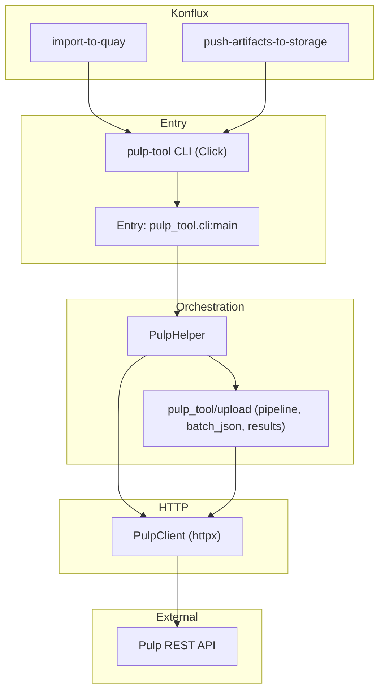

# Architecture (pulp-tool)

Living overview of **system design, boundaries, and constraints**.

Complements [README.md](../README.md) (users), [AGENTS.md](AGENTS.md) (agents: start with **Bootstrap**), and [CLAUDE.md](CLAUDE.md) (Tekton flags and paths). Detailed CLI flags: [cli-reference.md](cli-reference.md).

Template inspiration: [architecture.md](https://architecture.md/) · examples: [awesome-architecture-md](https://github.com/noahbald/awesome-architecture-md).

---

## 1. Repository overview

**pulp-tool** is a Python **library and Click CLI** that talks to a **[Pulp](https://pulpproject.org/)** instance over HTTP (RPM/file content, repositories, uploads, pulls). It is used **interactively** and **inside Konflux** (Tekton) steps to push build artifacts and write metadata consumed by downstream automation.

**Where it fits:** Artifact storage and CI integration for builds that land in Pulp-backed distributions—not a Brew/dist-git/Errata Tool component. Those systems are outside this repo; this client assumes a reachable Pulp API and (in Konflux) Tekton-staged workspaces.

### Repository layout (top level)

| Path | Purpose |
|------|---------|
| `pulp_tool/` | Library and Click CLI implementation |
| `tests/` | Pytest suite and fixtures |
| `e2e/` | Live Konflux e2e harness, Dockerfiles for e2e/cleanup images |
| `container/` | Konflux **`pulp-tool-container`** image (`Dockerfile`, build-args) |
| `docs/` | Architecture, CLI reference, agent docs (`AGENTS.md`, `CLAUDE.md`), ADRs |
| `skills/` | Portable agent skills (symlinked under `.cursor/skills`, `.agents/skills`) |
| `scripts/` | Maintainer and CI helper scripts |
| `.tekton/` | Konflux PipelineRuns and in-repo Tekton tasks |
| `.github/` | GitHub Actions, PR template, Renovate, Release Please, Codecov config |
| `config/` | Shared linter config (`pylintrc`, yamllint, codespell ignore list) |
| Root stubs | `AGENTS.md`, `CLAUDE.md` redirect to `docs/`; `pyproject.toml`, `uv.lock`, `Makefile`, `VERSION` |

Run **`make clean`** to remove local coverage, caches, and egg-info artifacts.

---

## 2. High-level diagram

**Pull / transfer data path:** **`pull`** and **`transfer`** → `artifact_pull_run.run_artifact_pull_flow` → **`PullService.run`** → `pulp_tool/pull/` (download, optional re-upload, side-tag publish) → `PulpClient` / `DistributionClient`.

**Upload data path:** CLI → `PulpHelper.setup_repositories` / `process_uploads` → `pulp_tool.upload.pipeline` + `batch_json` / `results` → `PulpClient` → Pulp. Layout and upload DTOs: `RpmRepoLayout`, `UploadLabels`, `DistributionUrlMap` (see [ADR 0003](adr/0003-upload-domain-and-layout-models.md)).

**Konflux:** Tasks invoke the same CLI with mounted config and `/var/workdir/results`; see [CLAUDE.md](CLAUDE.md) for exact flags and guardrails.

---

## 3. Core components (code map)

| Layer | Path | Role |
|-------|------|------|
| CLI | `pulp_tool/cli/` | **`upload-build`**, **`transfer`**, **`pull`**, **`update-build`**, …; shared download/promote runner in `artifact_pull_run.py`; options model in `pulp_tool/models/artifact_pull_run.py`; OCI/auth in `runner_helpers.py` |
| HTTP client | `pulp_tool/api/pulp_client/` | Session, chunked GET, RPM/content queries, repository ops |
| Other API surface | `pulp_tool/api/` (`artifacts/`, `content/`, `distributions/`, `repositories/`, `tasks/`) | Typed calls aligned with Pulp endpoints |
| Upload domain | `pulp_tool/upload/` | `pipeline`, `artifacts`, `batch_json`, `results`, `sbom` (CLI entry via `PulpHelper` only) |
| Orchestration | `pulp_tool/utils/pulp_helper.py` | Repo/distribution setup; delegates uploads to `pulp_tool.upload` |
| Services | `pulp_tool/services/` | **`PullService.run`** (download + optional destination upload for **`pull`** and **`transfer`**); `search_by_service`; `update_build` |
| Pull / transfer | `pulp_tool/pull/` + `pulp_tool/cli/artifact_pull_run.py` + `pulp_tool/models/artifact_pull_run.py` | Download helpers; **`ArtifactPullRunOptions`** → **`PullContext`**; **`pull`** = download only; **`transfer`** = promote via **`PullService.run`** |
| Results document | `pulp_tool/models/pulp_results/` (`document.py`, `normalize.py`, `lineage.py`, …) | Canonical **`PulpResultsDocument`**: in-place mutations; wire JSON uses **`pulp_labels`** only |
| Results JSON I/O | `pulp_tool/utils/results_json_io.py` | Local path or digest-pinned OCI ref → load/normalize document |
| Update build | `pulp_tool/services/update_build.py`, `pulp_tool/cli/update_build.py` | Signing/BTS mutations + ORAS publish (requires `--artifact-results`) |
| Snapshot update | `pulp_tool/utils/snapshot_update.py` | Release snapshot `pulpResultsOciManifest` after side-tag ORAS publish (trusted-artifact workspace) |
| ORAS results sync | `pulp_tool/utils/pulp_results_oci_publish.py` | Shared Pulp + ORAS publish for `upload-build` and **`transfer --side-tag`** |
| Models | `pulp_tool/models/` | Pydantic **`KonfluxBaseModel`**: context, Pulp DTOs, results, CLI option bundles — put validation and mapping on the model (see **pydantic-data-models** skill) |
| Utils | `pulp_tool/utils/` | Validation, logging, RPM helpers, session retries |
| Container | `container/Dockerfile`, `.tekton/pulp-tool-container-build-*.yaml` | Konflux Tekton → upstream `docker-build-oci-ta` (`buildah-oci-ta`); **changing-pulp-container** skill + [reference.md](../skills/changing-pulp-container/reference.md) |
| Tests | `tests/` (see [tests/README.md](../tests/README.md)), `tests/support/` | Fixtures, TLS helpers |

**Invariant:** production upload behavior is **CLI → `PulpHelper` → `pulp_tool.upload`** only; do not add a second orchestration path or library re-exports.

---

## 4. Data and configuration

| Kind | Location / system |
|------|-------------------|
| **Remote content & metadata** | Pulp server (repositories, distributions, RPM/file units, tasks) |
| **Credentials & base URL** | **`pulp-access` secret** from [pulp-access-controller](https://github.com/pulp/pulp-access-controller) (primary in Konflux): `cli.toml` + auth material; controller-managed [terms-based registry](https://access.redhat.com/terms-based-registry/accounts) credentials (not user-provisioned). Local/manual `cli.toml` or base64 via `--config`; env: TLS, proxy vars (see [README § Setup](../README.md#setup)) |
| **Local inputs** | RPM trees, logs, SBOM files, `pulp_results.json` / results JSON for batch upload |
| **Tekton workspace** | `/var/workdir/results`, optional `oras-staging/` (SBOM merge path in import-to-quay) |

No application database: state is on Pulp and in generated JSON artifacts.

---

## 5. External integrations

| System | Role |
|--------|------|
| **Pulp** | Primary API; plugins (e.g. RPM) assumed per deployment |
| **[pulp-access-controller](https://github.com/pulp/pulp-access-controller)** | Konflux operator: `PulpAccessRequest` → `pulp-access` secret (`cli.toml`, domain `konflux-<namespace>`); uses [terms-based registry](https://access.redhat.com/terms-based-registry/accounts) for credentials (controller-generated, not manual user setup) |
| **Konflux / Tekton** | Runs `pulp-tool` in `import-to-quay` and `push-artifacts-to-storage` (different config mounts and flags) |
| **Container registry** | Quay image for tooling (`pulp-tool-container`); ORAS publish uses `select-oci-auth` + Tekton-injected `~/.docker/config.json` (same pattern as import-to-quay Quay push); details in [CLAUDE.md](CLAUDE.md) |
| **OAuth / Basic** | Auth modes supported via client config (see [README](../README.md) / Pulp docs) |

---

## 6. Architecture invariants

1. **Single orchestration path** to production upload behavior: CLI commands go through `PulpHelper` → `pulp_tool.upload`.
2. **Konflux contracts** (flags, paths, skip-vs-fail) must stay aligned with linked upstream task YAMLs when changing `upload` or the image.
3. **Labels and APIs:** Pulpcore forbids `,`, `(`, and `)` in label **values**; `signed_by` replaces `,` with `:` and maps parentheses to `[` / `]` before upload and before RPM queries, so `pulp_label_select` is usually applied server-side together with checksum or NVR filters. Client-side label matching remains a fallback when a query cannot be expressed safely.
4. **Merge gate:** PR diffs require **100% diff coverage** (`make test-diff-coverage`), not only line coverage in unchanged code.
5. **Side-tag RPM repos:** `transfer --side-tag` uses Pulp repository/distribution path **`<sanitized-tag>` only** (shared across source builds with the same tag; no `side-tag-` prefix, no `/rpms` segment). **Transfer** mainline destination aggregate repos use `konflux-<source-domain>/<source-repo>/{rpms|logs|sbom|artifacts}` (source **`cli.domain`** from `--source-config` and the build segment of `build_id`), not plain `{build}/…` under the destination domain. Multi-build test flows reuse one `--side-tag` and may chain **`--artifact-location`** from the latest OCI digest ref (Tekton **`--artifact-results`** or ORAS publish), not from a field inside `pulp_results.json`.

---

## 7. Key design decisions

Formal records: [ADR 0000 — how we record decisions](adr/0000-record-architecture-decisions.md); other ADRs live under [docs/adr/](adr/). Examples in-repo: Python 3.12 (CI, container image on UBI 10), httpx. High level:

- **httpx** for HTTP (async-capable client, retries for transient errors in session layer).
- **Click** for CLI; optional plugin entry points for command discovery.
- **Pydantic v2** for models and validation.

---

## 8. Known concerns / technical debt

- **Upstream pipeline drift:** Tekton tasks and workspace layout (ORAS, `oras-staging/`) can change; [CLAUDE.md](CLAUDE.md) must be refreshed when call sites move.
- **Pagination / broad queries:** Fallback paths that list RPM content and filter client-side can be heavier on large Pulp instances—monitor performance if extended.
- **Complex `q` filters:** Pulp enforces expression complexity limits; client code chunks queries accordingly.

---

## 9. Deployment and operations

| Mode | How it runs |
|------|----------------|
| **Local / automation** | `pip install` / `pip install -e .`; `pulp-tool` on PATH |
| **Konflux** | Container image from `.tekton/` build; read-only mounts for config and workspace |
| **Scale** | Client-side concurrency (global `--max-workers` for **`pull`** and **`transfer`** downloads); upload parallelism via [`pulp_tool/utils/client_limits.py`](../pulp_tool/utils/client_limits.py); bounded by Pulp API and network |

### Memory and Konflux pods

Tekton steps are short-lived: each command should use one `PulpClient` and call **`close()`** in a `finally` block (upload / pull / transfer CLIs already do). That releases sync/async HTTP pools and clears the GET response cache.

**What still scales with workload** (not leaks, but peak RSS):

- Parallel RPM uploads (per-architecture thread pool × per-arch RPM workers).
- Chunked Pulp GET queries that merge large `results` lists in memory.
- `PulpResultsDocument` and artifact metadata built during upload.

**Default limits** (override with `PULP_TOOL_*` environment variables):

| Setting | Default | Env variable |
|---------|---------|----------------|
| HTTP connection pool (`PulpClient` sync + async) | 24 | `PULP_TOOL_HTTP_MAX_CONNECTIONS` |
| GET cache max entries | 64 | `PULP_TOOL_GET_CACHE_MAX_ENTRIES` |
| GET cache TTL (seconds) | 300 | `PULP_TOOL_GET_CACHE_TTL` |
| Parallel RPM uploads per architecture | 2 | `PULP_TOOL_MAX_UPLOAD_WORKERS` |
| Parallel architecture upload threads | 3 (capped by arch dirs present) | `PULP_TOOL_MAX_ARCH_UPLOAD_WORKERS` |

`pull` and `transfer` honor global `--max-workers` but caps concurrent downloads to the HTTP connection budget. Raise env values on larger workers if upload, pull, or transfer becomes CPU/network bound.

---

## 10. Security (high level)

- **Secrets:** Never commit; Konflux uses controller-generated **`pulp-access`** / **`rok-access`** mounts (see [pulp-access-controller](https://github.com/pulp/pulp-access-controller)); local dev uses `cli.toml` outside VCS.
- **TLS:** HTTPS with certificate verification enabled; cert/key or username/password for distribution pull; see [README § Setup](../README.md#setup) and [cli-reference.md](cli-reference.md).
- **RBAC:** Pulp server enforces access; content labeling may require `core.content_labeler` (Pulp docs).

---

## 11. Development and testing

- **Setup:** [CONTRIBUTING.md](../CONTRIBUTING.md); `make install-dev` and the full command list live in [README.md § Development](../README.md#development).
- **Tests:** `pytest`, `make test`, `make test-diff-coverage` (after `git fetch origin` for PR-style diff coverage).
- **Quality:** Ruff (lint + format, S ruleset), Pylint (errors only), Mypy; yamllint, ShellCheck, hadolint, codespell, pip-audit, and Checkton in CI; `make pre-commit-ci` or `pre-commit run --all-files` plus pre-push stage (see [CONTRIBUTING.md](../CONTRIBUTING.md)).

---

## 12. Glossary

| Term | Meaning |
|------|---------|
| **Pulp** | Open-source repository management; REST API for content and publications |
| **Konflux** | Kubernetes-native CI/CD (Tekton) platform; see [konflux-ci.dev](https://konflux-ci.dev/docs/) |
| **PRN / pulp_href** | Pulp resource identifiers in API responses |
| **pkgId** | RPM content id (often SHA256) used in list filters |
| **pulp_label_select** | Pulp query parameter for JSON labels; commas in values have parser limitations |
| **SBOM** | Software bill of materials file path in upload flows |
| **`pulp_results.json`** | Aggregated artifact metadata JSON produced/consumed by uploads |
| **Build Pulp** | Build-time artifact storage for a Konflux tenant (`pulp-access` secret → `/pulp-access/cli.toml`) |
| **Release Pulp** | Release-time artifact storage target for promoted builds (`rok-access` secret → `/etc/rok-access/cli.toml`) |
| **Side-tag** | Named test promotion repo (sanitized `--side-tag` path only) populated during `transfer --side-tag` |
| **Transfer** | CLI command: download from build Pulp or OCI `pulp_results`, re-upload to **release Pulp**; distinct from download-only **`pull`** |

---

## 13. Project identification

**Repository:** pulp-tool · **Python package:** `pulp_tool` · **CLI:** `pulp-tool`

Keep this document current when adding major packages, changing Konflux boundaries, or revising upload/pull flows.
